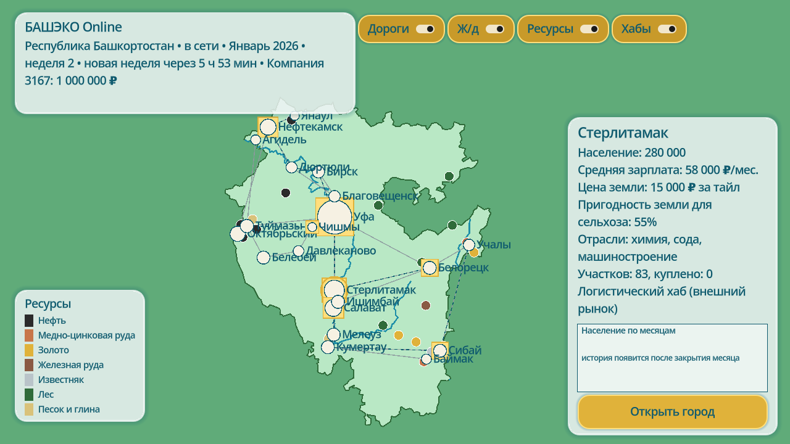
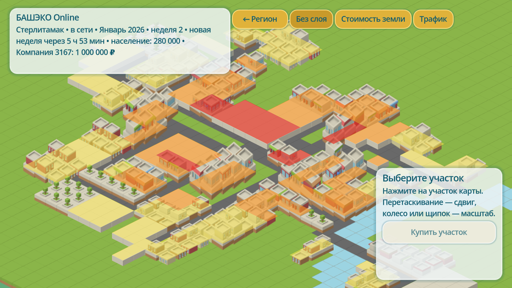

# БАШЭКО Online — дорожная карта (версия 2)

**Игра:** онлайн-копия **Capitalism 2 / Capitalism Lab** ([capitalismlab.com](https://www.capitalismlab.com/)) на карте **Республики Башкортостан**,
с живыми игроками и **ИИ-игроками**. Платформа клиента — Godot 4 (Android).

Версия 2 заменяет прежнюю карту: предыдущие этапы уходили в сторону (абстрактные «предприятия», биржа игроков, константный спрос).
Детали механик — [docs/GAME_DESIGN.md](docs/GAME_DESIGN.md), время — [docs/TIME_MODEL.md](docs/TIME_MODEL.md),
техническая архитектура — [docs/GAME_ARCHITECTURE.md](docs/GAME_ARCHITECTURE.md).

## 1. Правила мира

| | |
|---|---|
| **Игровое время** | 1 игровой день = 1 час; неделя = 6 дней = 6 часов; месяц = 24 дня = 1 реальные сутки; год = 12 суток |
| **Пересчёт мира** | каждый игровой день (тик каждый час); недельные расчёты — каждые 6 часов; месячные — в 09:00 по Уфе |
| **Начало нового месяца** | 09:00 по уфимскому времени (UTC+5) |
| **Режим** | онлайн: люди + ИИ в одном мире; игрок может быть вне сети в момент тика |
| **Источник истины** | сервер; клиент отправляет только намерения |
| **Карта** | реальные города и ресурсы РБ, вымышленные компании и бренды |
| **Торговля** | договоры поставок + розница потребителям (как в Capitalism), без общей биржи заказов |

## 2. Что уже сделано и что с этим делать

| Сделано (прототип) | Решение |
|---|---|
| Сервер: Fastify, WebSocket, Zod-протокол, сессии, reconnect, rate limit | **Оставляем** (этап 0) |
| Регистрация/вход, компании, баланс через журнал (ledger), идемпотентность, аудит, миграции, тесты | **Оставляем**, расширяем (этап 3) |
| Godot-клиент: сеть, изометрическая карта, спрайты Kenney (CC0), тема интерфейса | **Оставляем** как основу клиента; карту и UI переделываем под новые данные |
| Генератор растущего органичного города, участки, покупка, постройка | **Переиспользуем идеи** для планов городов (этап 2) и динамики города (этап 13); модель данных пересматриваем |
| Экономический день, рецепты «предприятий», зарплаты, NPC-торговый дом, налог с розницы, кредиты, банкротства | **Удалены в этапе 1**; вместо них — недельный тик и (этапы 5–14) настоящие механики |
| «Этап 4: рынок игроков / аукционы» из старой карты | **Удалён**: в Capitalism нет биржи; вместо неё — этап 8 (поставки) и 9 (розница) |

Соответствие старых этапов новым: старые 1–2 → этап 0; 3 → прототип, заменяется 5–7, 9, 12–14; 4 → удалён; 5 → 8; 6 → 2;
7 → 4 и 13; 8 → 5–7; 9 → 14 и 16; 10 → 17; 11–13 → 0 и 18.

> **Решение принято:** шаг симуляции — игровой день (1 реальный час), месяц = 24 дня; недельные расчёты каждые 6 часов — надстройка. См. [docs/TIME_MODEL.md](docs/TIME_MODEL.md).

## 3. Порядок и зависимости

```
0 Фундамент ─► 1 Время/тики ─► 2 Карта РБ ─► 2.5 Сетка и габариты ─► 3 Компании и учёт ─► 4 Здания и стройка
                                                  │                        │
                       5 Сырьё и сельхоз ◄────────┴──────────┬─────────────┘
                                                             ▼
          6 Каталог товаров ─► 7 Заводы ─► 8 Поставки и логистика ─► 9 Розница и спрос
                                                             │              │
                          10 Бренд и реклама ◄───────────────┴──────────────┤
                          11 НИОКР ◄─────────────────────────────────────────┤
                          12 Персонал и управление ◄─────────────────────────┤
                          13 Недвижимость и город ◄──────────────────────────┤
                          14 Финансы, налоги, акции ◄────────────────────────┘
                                         ▼
                       15 ИИ-игроки ─► 16 Онлайн-мир и режимы ─► 18 Баланс и эксплуатация
                       17 Клиент (параллельно со всеми) ──────────► 19 После релиза
```

Этап 17 (клиент) идёт параллельно: каждый серверный этап заканчивается рабочим экраном в Godot.

## 4. Этапы

Статус: **✅ выполнено**, **🟡 частично / прототип**, **⬜ не начато**. Критерий готовности этапа — все пункты отмечены **и** тесты зелёные **и** этап влит в `main`.

### Этап 0. Фундамент ✅

- [x] Сервер на TypeScript/Fastify/ws, Zod-протокол v1, сессии, reconnect, heartbeat, rate limit, идемпотентность `request_id`
- [x] PostgreSQL: миграции, журнал операций (ledger), аудит, транзакции
- [x] Регистрация, вход, профиль, гость
- [x] Godot-клиент: сеть, тема интерфейса, изометрический вид, headless-проверки
- [x] CI для backend; конфигурация сервера и клиента; docker-compose для локальной БД
- [ ] CI для Godot
- [ ] Вынести «правила мира» (константы, каталоги) в файлы данных

### Этап 1. Игровые часы и недельный тик ✅

Основа всего остального: без неё нельзя считать экономику. Спецификация — [TIME_MODEL.md](docs/TIME_MODEL.md).

- [x] Постоянные часы мира (`world_clock`): epoch (09:00 по Уфе), seed, номер тика, ускорение для разработки; журнал тиков `world_ticks`
- [x] Календарь: игровой день = 1 ч, неделя = 6 дней, месяц = 24 дня = 24 ч с 09:00 по Уфе (UTC+5), год = 12 месяцев; игровая дата и русские названия месяцев (изначально был недельный тик, переведён на суточный)
- [x] Планировщик тиков: одна транзакция на тик, уникальный номер, advisory-лок, детерминизм по (seed, тик, фаза)
- [x] Каркас фаз дня: стройка → добыча → производство → поставки → розница → аренда/зарплаты → ИИ/политики → события; в сводке тика нереализованные фазы помечены `not_implemented` с номером этапа (наполняются этапами 4–15)
- [x] Каркас недельных (каждые 6 дней), месячных (ровно в 09:00 по Уфе) и годовых операций
- [x] Догоняющий расчёт после простоя (без пропусков, до 48 тиков за вызов); новый мир не «догоняет» прошлое
- [x] `world_snapshot.clock`: год, месяц, неделя, моменты следующей недели и месяца; клиент показывает дату и обратный отсчёт
- [x] Тесты (20): граница месяца в 09:00 по Уфе, независимость от часового пояса процесса, 4 тика в сутки, смена года, отсутствие двойного выполнения, откат тика при ошибке, догоняющий расчёт, детерминизм, перезапуск, ускоренный мир по WebSocket
- [x] Удалён прежний «экономический день», NPC-торговый дом, кредиты и цены прототипа (миграция 008); оставлена только казна и прототипная фаза `city_dynamics`
- [ ] Отдельные push-уведомления «началась неделя/месяц» (сейчас клиент видит смену тика в snapshot)
- [ ] Администрирование часов (пауза мира, ручной сдвиг) — до этапа 16

**Готово:** мир сам идёт по неделям и месяцам, перезапуск сервера ничего не ломает, клиент показывает дату и таймер.

### Этап 2. Карта Республики Башкортостан ✅




- [x] Модель региона: 21 город (Уфа, Стерлитамак, Салават, Нефтекамск, Октябрьский, Ишимбай, Белорецк, Кумертау, Сибай, Туймазы, Мелеуз, Белебей, Бирск, Учалы, Благовещенск, Дюртюли, Давлеканово, Баймак, Агидель, Янаул, Чишмы), координаты, население; реальный контур РБ и реки (Natural Earth, public domain)
- [x] Показатели города: население, зарплата, цена земли, пригодность земли, специализация; помесячная история (экономические графики) пишется месячным хуком тика
- [x] Транспортная сеть (схематичная): автодороги и железные дороги, расстояния по сети (Дейкстра), формула фрахта (фиксированная часть + км × ставка, авто/ж/д), команда `region.freight_quote`
- [x] Логистические хабы (аналог «портов»): 7 ж/д-узлов и терминалов с направлением внешнего мира
- [x] Природные ресурсы: 27 участков семи видов (нефть, медно-цинковая руда, золото, железная руда, известняк, лес, песок/глина) с запасами и качеством, привязка к ближайшему городу, таблица `resource_sites`
- [x] План каждого города из участков (генератор по seed, река/без реки, размер по данным), оверлеи «стоимость земли» и «трафик покупателей» на каждом участке; цена участка зависит от них
- [x] Данные в файлах `data/rb/*.json` с валидатором (схемы Zod + межфайловые проверки: ссылки, дубликаты, связность сети, контур); значения помечены как приближённые
- [x] Региональная карта и карта города в Godot: масштаб/сдвиг, слои (дороги, ж/д, ресурсы, хабы), карточки города и месторождения с графиком, переход регион ↔ город, оверлеи
- [ ] Точные данные из открытых источников (Башстат, геология) вместо приближённых; настоящая геометрия дорог и железных дорог
- [ ] Планы городов процедурные, а не по реальной застройке; транспортная связность внутри города не влияет на трафик
- [ ] Показатели городов (зарплаты, цена земли) пока статичны; динамика — этапы 13–14
- [ ] Истощение и появление новых месторождений, право собственности на участок сырья — этап 5

**Готово:** на карте РБ видны города с характеристиками, ресурсами и транспортом, внутри каждого — план участков с оверлеями.

### Этап 2.5. Сетка и габариты зданий ⬜ (требование: всё на картах привязано к сетке)

Сейчас: карта города уже на клетках, но «участок» — прямоугольник произвольного размера, игровое здание растягивается на весь участок, декоративная
застройка — отдельные спрайты на клетках; региональная карта нарисована по широте/долготе. Нужно привести всё к единой сетке.

- [ ] **Клетка — единица земли.** Зона, стоимость земли, трафик, владелец и цена — у клетки; покупка клетки и прямоугольника клеток (вместо «участков» произвольных размеров)
- [ ] **Здания с габаритами W×H** (в данных каталога): прямоугольник из целых клеток, поворот на 90°, нет растягивания спрайтов; примеры: магазин, квартира, офис, склад, завод, ферма, шахта — размеры уточнить по оригиналу [K]
- [ ] Правила размещения: все клетки свободны и принадлежат строящему, подходят по зоне/рельефу, нет пересечений; опционально — выход к дороге
- [ ] Городская застройка (NPC) — тоже здания с габаритами на клетках, растёт постепенно (небольшие дома → крупные); дороги, вода, мосты — типы клеток
- [ ] Региональная карта — сетка ячеек (≈10 км): города, месторождения, хабы, фермы в ячейках; дороги и железные дороги по ячейкам; расстояния — по сетке
- [ ] Миграция данных: `map_lots` → клетки/участки + таблица `buildings` (id, город, x, y, W, H, тип, владелец, состояние); существующие предприятия переносятся
- [ ] Графика: спрайты под габариты (1×1, 2×2, 3×3 …) — подбор/доработка; рендер по футпринту (изометрия по клеткам)
- [ ] Клиент: выбор клетки/прямоугольника, предпросмотр футпринта и валидности размещения, перенос и снос
- [ ] Тесты: размещение без пересечений, границы и владение, повороты, миграция, рост городской застройки по клеткам

**Готово, когда:** любое здание стоит на целом числе клеток своих габаритов, ни одного растянутого спрайта, регион и города — на сетке.

### Этап 3. Компании, учёт, земля ⬜

- [ ] Создание компании, стартовый капитал по режимам/сложности, несколько компаний у игрока (лимит)
- [ ] Двойная запись: активы, обязательства, капитал; баланс и отчёт о прибылях и убытках по месяцам; денежный поток
- [ ] Чистая стоимость и рейтинги игроков
- [ ] Покупка и продажа участков, цена от района, налог на землю (подготовка к этапу 14)
- [ ] Уведомления компании (события, отчёты)
- [ ] Переиспользование текущего ledger, идемпотентности и аудита

**Готово, когда:** у компании есть корректный баланс и месячный отчёт, участки покупаются и продаются.

### Этап 4. Здания и строительство ⬜

- [ ] Каталог типов зданий в данных: ферма, добывающий объект, завод, склад, магазин, офис/HQ, жилой дом, исследовательский центр
- [ ] Строительство занимает игровое время (недели), стоимость зависит от города и участка; отмена, снос
- [ ] Постройка на купленном участке с зонированием; состояния здания (строится / работает / простаивает)
- [ ] Дублирование и перенос фирм (после этапа 7)
- [ ] Отображение зданий на карте города

**Готово, когда:** можно купить участок, начать стройку, дождаться тика и получить работающее здание.

### Этап 5. Сельское хозяйство и сырьё ⬜

- [ ] Фермы: культуры и животноводство, продукция в единицах за неделю, качество растёт с обучением (до 100)
- [ ] Добыча: нефть, руды, лес, известняк, соль — только на участках-месторождениях, истощение, качество участка
- [ ] Появление новых месторождений по мере выкупа (против монополии)
- [ ] Вывод продукции на склад и в поставки
- [ ] Данные: сельхозпригодность районов; сезонность — опционально

**Готово, когда:** ферма или добывающее предприятие производят товар, который можно отправить дальше.

### Этап 6. Каталог товаров и рецептов ⬜

- [ ] Классы товаров и товары (≈100–200 к релизу): еда, топливо и химия, стройматериалы, металлы, текстиль, мебель, электроника, транспорт, медицина…
- [ ] Региональные товары: мёд, кумыс и молочные, войлок, конские изделия, нефтепродукты, полимеры, грузовики, золотые украшения
- [ ] Свойства: базовая цена, диапазон качества, веса рейтинга (бренд/качество/цена), эластичность спроса, фрахтовый вес
- [ ] Рецепты (вход → выход), требуемые технологии и инфраструктура
- [ ] Валидатор данных, импорт в БД, версионирование каталога

**Готово, когда:** каталог загружается из файлов, проходит валидацию, на него опираются заводы и магазины.

### Этап 7. Заводы и производство ⬜

- [ ] Завод из юнитов: закупка, производство, продажа; уровни и мощность
- [ ] Выпуск по рецептам, зависимость качества от технологий, персонала, сырья
- [ ] Склад завода, остатки, простой при нехватке сырья
- [ ] Цены продажи, внутренняя продажа
- [ ] Планировка юнитов (позже — как расширение), библиотека планов
- [ ] Инструменты анализа: узкие места, загрузка

**Готово, когда:** завод получает сырьё по связям и выпускает товар заданного качества.

### Этап 8. Цепочки поставок и логистика ⬜

- [ ] Связи снабжения/договоры «поставщик → покупатель»: цена, объём, срок; выбор по цене, качеству, бренду
- [ ] Каталог поставщиков (руководство производителей), поиск, сравнение
- [ ] Фрахт по расстоянию и виду транспорта (авто/ж/д), стоимость в отчётах
- [ ] Склады, лимиты, логистические хабы как внешние поставщики с ограниченным предложением
- [ ] Автоматическая продажа конкурентам и внутренняя продажа; переключение и перенаправление поставщиков пакетом
- [ ] Недопоставки, штрафы, расторжение
- [ ] Визуализация цепочки

**Готово, когда:** игрок строит цепочку «ферма → завод → магазин» и видит стоимость фрахта и узкие места.

### Этап 9. Розница и потребительский спрос ⬜ (сердце игры)

- [ ] Магазины: форматы (универсальный, специализированный, супермаркет…), полки до 12 товаров, цены, запасы
- [ ] Спрос по городам и товарам: население × доходы × потребность, эластичность
- [ ] Рейтинг товара: бренд, качество, цена с весами по товарам; сравнение со средним по городу; трафик и удобство локации
- [ ] Модель выбора потребителей, доли рынка, недельные продажи
- [ ] Недостаток товара, перепроизводство, распродажи
- [ ] Отчёты по товарам и рынкам; индикаторы избытка и дефицита
- [ ] Симуляционный стенд: прогон сотен недель для калибровки

**Готово, когда:** магазин продаёт товары с понятной зависимостью от цены, качества, бренда и места.

### Этап 10. Маркетинг и бренд ⬜

- [ ] Рекламные бюджеты и модули в магазинах/медиа
- [ ] Рейтинг бренда по товару и компании, накопление и затухание
- [ ] Стратегии бренда (корпоративный / по товарам), mega product class
- [ ] Влияние на рейтинг (этап 9) и цены

### Этап 11. Исследования и технологии ⬜

- [ ] Исследовательские центры, проекты с длительностью в игровых месяцах (масштабированной под наше время)
- [ ] Технологический прирост → качество товаров; изобретение новых товаров; устаревание
- [ ] Покупка технологий у конкурентов (при наличии HQ/CTO)
- [ ] Экспертиза и очки знаний

### Этап 12. Персонал и управление ⬜

- [ ] Зарплаты по городам, навыки и обучение (ползунок на фирму, бюджет HR, интенсивная программа)
- [ ] Штаб-квартира и офисы: COO/CTO/CMO, экспертиза, политики управления
- [ ] **Автоматизация для игроков вне сети:** авто-цены, авто-закупки, авто-реклама (критично из-за тиков раз в 6 часов)
- [ ] Менеджеры фирм

### Этап 13. Недвижимость и динамика города ⬜

- [ ] Жилые и коммерческие здания, квартиры, аренда, заполняемость
- [ ] Динамика города: население, рабочие места, спрос, зарплаты, цены на землю, застройка (переиспользовать идеи роста города из прототипа)
- [ ] Общественные объекты (опционально), случайные городские события

### Этап 14. Финансы, налоги, фондовый рынок ⬜

- [ ] Макроэкономика: инфляция, индексация зарплат и цен
- [ ] Кредиты (до доли активов), проценты, досрочное погашение; облигации; кредитный рейтинг
- [ ] Налоги: упрощённая российская схема (НДС, прибыль, имущество, земля)
- [ ] Фондовый рынок: IPO, акции, дивиденды, выкуп, поглощения (владелец ≥50%)
- [ ] Банкротство и ликвидация; страхование (опционально)
- [ ] Годовые отчёты и рейтинги

### Этап 15. ИИ-игроки ⬜

- [ ] Каркас ИИ-компании: решения на каждом тике **через те же команды**, что и у людей
- [ ] Персоны: компетентность и стиль (от агрессивного до консервативного), сложность
- [ ] Стратегии: розничная сеть, производитель, фермер/добыча, девелопер
- [ ] Заполнение мира ИИ при малом числе людей; замена вышедших игроков
- [ ] Симуляции «только ИИ» на сотни игровых лет для проверки устойчивости и баланса

### Этап 16. Онлайн-мир и режимы ⬜

- [ ] Экземпляры мира: seed, epoch, длина сезона, число слотов людей и ИИ
- [ ] Вход в идущий мир: стартовый капитал, защита новичков
- [ ] Режимы: песочница, сезон с рейтингом, сценарии/вызовы с целями и сроком, Hall of Fame
- [ ] Дипломатия и общение (минимум), жалобы, администрирование
- [ ] Резервное копирование и восстановление мира, сброс сезона

### Этап 17. Клиент Godot / Android (параллельно) 🟡

- [x] Сеть, тема, изометрическая карта (прототип)
- [ ] Региональная карта РБ, карта города с оверлеями, фильтры
- [ ] Окна фирм: стройка, завод (юниты), магазин (полки), склад, ферма/шахта, HQ
- [ ] Отчёты: финансы, товары, рынок; граф цепочки поставок
- [ ] Уведомления; игровые часы с отсчётом до недели/месяца
- [ ] Обучение (быстрый старт-уроки: розница, анализ рынка, ферма, завод, бренд, НИОКР, сырьё, акции)
- [ ] Android: сборка, производительность, safe area, проверка на устройстве, локализация (ru, затем en)
- [ ] Игровая графика в стиле проекта вместо временных спрайтов

### Этап 18. Баланс, тестирование, эксплуатация ⬜

- [ ] Симуляционный стенд и целевые показатели (сроки окупаемости, маржи по отраслям, доли рынка)
- [ ] Нагрузочные и soak-тесты, тесты восстановления, защита от эксплойтов и ботов
- [ ] Мониторинг, резервные копии, миграции без потери данных
- [ ] Docker Compose, staging, HTTPS — **только после отдельного разрешения на VPS**
- [ ] Права на графику, шрифты и названия подтверждены

### Этап 19. После релиза (по мотивам Capitalism Lab) ⬜

- [ ] Дочерние компании и ИИ-директора
- [ ] Цифровая эпоха: ПО, интернет, телеком
- [ ] Городская политика: мэр, партии, рейтинги городов
- [ ] Медиа-компании, общественные и спортивные объекты, многоэтажные магазины
- [ ] Редактор карт и продуктов, моды и скрипты (данные уже в файлах)

## 5. Вехи (играбельные срезы)

| Веха | Содержит этапы | Что можно сделать |
|---|---|---|
| **A. «Первая прибыль»** | 1, 2 (Уфа + 3–4 города), 3, 4, 8 (хаб), 9 (базовая) | Купить участок в Уфе, построить магазин, закупить товар у хаба, продавать жителям, увидеть месячный отчёт |
| **B. «Вертикаль»** | + 5, 6, 7, 8 | Ферма → завод → магазин, фрахт, склады |
| **C. «Конкуренция»** | + 10, 11, 12, 15 | Бренд, НИОКР, менеджеры, ИИ-соперники |
| **D. «Большой бизнес»** | + 13, 14 | Недвижимость, кредиты, налоги, акции, поглощения |
| **E. «Онлайн-бета»** | + 16, 17, 18 | Сезонный мир с людьми и ИИ на Android |

## 6. Открытые решения (значения по умолчанию)

| Вопрос | По умолчанию, пока не решено иначе |
|---|---|
| Один постоянный мир или сезоны? | Сезоны фиксированной длины (например, 10 игровых лет = 120 суток) + песочница |
| Число людей в мире | 5–30; остальное заполняют ИИ |
| Стартовый капитал | Зависит от режима; для песочницы — порядка 10–50 млн ₽ |
| Масштаб сроков исследований | 1…12 игровых месяцев вместо «6 месяцев…10 лет» |
| Покупка участков в городе | Фиксированные участки с ценой по району (как в оригинале), без аукционов |
| Языки | Русский, затем английский |

## 7. Правила работы

1. Каждый этап разрабатывается в отдельной feature-ветке, проходит тесты, PR, проверку и merge в `main`; SHA merge-коммита фиксируется.
2. Все числа — гипотезы, пока не откалиброваны симуляцией (этап 18); данные — в файлах, не в коде.
3. Источники механик помечаются как [S] (проверено по материалам игры) или [K] (по общим знаниям — сверять с оригиналом) в `docs/GAME_DESIGN.md`.
4. Клиент не является источником истины для денег, товаров, собственности и времени.
5. VPS не изменяется, production не запускается, APK не публикуется без отдельного разрешения.
6. Не заявлять готовность MMO без теста с несколькими клиентами, ИИ-игроками и сохранением состояния.
7. Все объекты на картах (регион и города) привязаны к сетке клеток; здания занимают целое число клеток своих габаритов.
